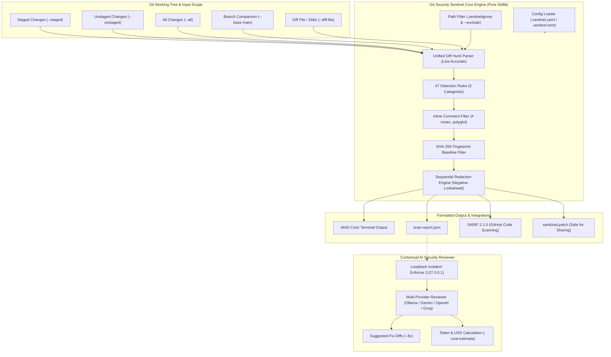

# Git Security Sentinel

> **Catch risky Git changes before they become security incidents.**

[](LICENSE)
[](https://www.python.org/)
[](https://agentskills.io/specification)
[](https://github.com/pre-commit/pre-commit)
[](https://docs.oasis-open.org/sarif/sarif/v2.1.0/sarif-v2.1.0.html)
[-success)](src/git_security_sentinel/)
[](https://github.com/INSVikrant54/Git-Security-Sentinel/actions)

---

## ⚡ 30-Second Start

```bash
pip install git-security-sentinel
git scan --init
git scan --ai
```

`git scan --init` creates the config, ignore file, `.env.example`, and pre-commit hook **for you** — nothing to write by hand. If you already have a cloud API key, include it in the same command:

```bash
git scan --init --key GEMINI_API_KEY=your-key
```

Everyday use:

```bash
git scan                          # staged changes if any exist, otherwise all uncommitted changes
git scan --ai                     # scan + AI triage, no flags required
git scan --oneline                # one line per finding
git scan --explain <rule-id>      # what a rule means and how to fix it
```

---

## 1. Overview

**Git Security Sentinel** is a deterministic, privacy-first Git security scanner, developer CLI, and Agent Skill designed to safeguard the software development lifecycle before code is committed or published.

It inspects Git diffs for leaked API keys, tokens, connection strings, sensitive committed files, and dangerous code patterns using **47 detection rules** across 5 categories. Operating with **zero runtime dependencies outside the Python standard library**, Git Security Sentinel features SARIF 2.1.0 output for GitHub Advanced Security, native pre-commit framework support, inline comment suppression (`# nosec`), baseline migration, and an optional multi-provider contextual AI reviewer with suggested remediation diffs (`--fix`) and cost estimation (`--cost-estimate`).

---

## 2. Core Features

- ⚡ **Zero Runtime Dependencies**: Pure Python standard library implementation (Python 3.9+). Core scanner and AI reviewer require no third-party package installations.
- 🛡️ **47 Static Detection Rules**: Comprehensive coverage across Cloud Provider Keys, Auth Tokens, Database URIs, Sensitive Committed Files, Insecure Code Patterns (CWE-78, CWE-89, CWE-502, CWE-611, etc.), and License Compliance.
- 🔒 **Guaranteed In-Memory Secret Redaction**: Deterministic sanitization replaces secrets with typed `[REDACTED:<TYPE>]` tokens before terminal rendering, JSON reporting, SARIF export, or AI prompt delivery. Negative lookahead ensures specific vendor tokens are never overwritten by generic credential regexes.
- 📊 **OASIS SARIF 2.1.0 Schema Compliance**: Export scan results directly to SARIF (`--format sarif`) for instant integration with GitHub Code Scanning alerts and security dashboards.
- 🪝 **One-Command Setup**: `git scan --init` creates starter config, ignore rules, `.env.example`, and installs the pre-commit hook automatically — no manual file creation.
- 🪝 **Pre-Commit Framework & Direct Hook Installer**: Drop-in `.pre-commit-hooks.yaml` support or direct installation into `.git/hooks/pre-commit` via `git-scan --install-hook`.
- 🔕 **Granular False-Positive Suppression**: Support for line-level `# nosec` and `# sentinel:ignore` comments, polyglot syntax (`#`, `//`, `--`, `/* */`), rule-specific directives, `.sentinelignore` path exclusions, and CLI `--exclude`.
- 📋 **Baseline Migration for Legacy Codebases**: Suppress known historical debt with `--baseline .sentinel.baseline` using stable SHA-256 fingerprints resilient to line shifts.
- ⚙️ **Pure Stdlib Configuration**: Load project defaults from `.sentinel.yaml` or `.sentinel.toml` parsed completely with standard library utilities (no PyYAML required).
- 🤖 **Contextual AI Reviewer with `--fix` & `--cost-estimate`**: AI triage supporting local Gemma via Ollama (100% offline and loopback-restricted) as well as Google AI Studio, OpenAI, and Groq. Generates non-mutating remediation diffs and transparent USD query cost estimations.
- 🧭 **Low-Effort CLI**: `git scan` and `git scan --ai` work with no flags; `--oneline`, `--explain <rule>`, `--completion <shell>`, and `--format github` keep daily use and CI simple.
- 🔄 **Self-Update Capability**: Integrated 24-hour cached PyPI version checker and one-command upgrade via `git-scan --upgrade`.

---

## 3. Architecture & Workflow



---

## 4. Installation

### Option 1: Install via pip
```bash
pip install git-security-sentinel
```

### Option 2: Install from Source (Editable Development)
```bash
git clone https://github.com/INSVikrant54/Git-Security-Sentinel.git
cd Git-Security-Sentinel
pip install -e .
```

### Option 3: Zero-Install Standalone Execution
Git Security Sentinel has zero runtime dependencies and can be executed directly from a cloned repository:
```bash
# Direct module execution:
python -m git_security_sentinel --staged

# Or via backwards-compatible script wrappers:
python scripts/scan_diff.py --staged
```

---

## 5. Everyday Commands

### Set up a repository once
```bash
git scan --init
```
This creates `.sentinel.yaml`, `.sentinelignore`, `.env.example`, and installs the pre-commit hook. Existing files are never overwritten unless you pass `--force`. To save a cloud key in the same step:
```bash
git scan --init --key GEMINI_API_KEY=your-key
```

### Scan
```bash
git scan                 # staged changes if you staged any, otherwise all uncommitted changes
git scan --oneline      # concise one-line-per-finding output
git scan --staged        # explicit staged-only scan
```

### AI review
```bash
git scan --ai                          # scan + AI triage with zero flags
git scan --ai --fix --cost-estimate    # with remediation diffs and cost
git-sentinel-ai --report scan-report.json --fix
```
AI defaults come from the `.sentinel.yaml` created by `--init` or from `SENTINEL_AI_*` environment variables. With no cloud key, local Ollama is used (`ollama pull gemma3:4b`).

### Understand a finding
```bash
git scan --explain secret.aws_access_key
```

### CI / Pull Requests
```bash
git scan --format github                                   # inline PR annotations
git scan --base main --format sarif --output results.sarif # GitHub Code Scanning
```

---

## 6. CLI Reference

### `git-scan` / `git-security-sentinel`

The primary scanner CLI inspects diffs, evaluates rules, filters suppressions, and formats findings:

```
usage: git-scan [-h] [scan] [--staged | --unstaged | --all | --base BRANCH |
                --diff-file FILE] [--version] [--repo-root PATH]
                [--format {text,json,sarif,github}] [--init] [--explain RULE_ID]
                [--completion {powershell,bash,zsh,fish}] [--oneline]
                [--key NAME=VALUE] [--install-hook] [--force]
                [--upgrade] [--no-update-check] [--output FILE]
                [--redacted-diff-out FILE]
                [--severity-threshold {critical,high,medium,low}]
                [--exclude PATTERN] [--baseline FILE] [--create-baseline]
                [--config FILE] [--no-color] [--color] [--verbose] [--quiet]
                [--ai] [--provider {auto,ollama,gemini,openai,groq}]
                [--model MODEL_NAME] [--ai-endpoint URL] [--allow-remote]
                [--ai-timeout SECONDS] [--fix] [--cost-estimate]
```

The same CLI is available as a Git subcommand — `git scan --ai` is equivalent to `git-scan --ai` (Git delegates `git scan` to the `git-scan` executable).

#### Diff Scope Options (Mutually Exclusive)
- `--staged`: Scan staged (index/cached) git changes.
- `--unstaged`: Scan unstaged working directory changes.
- `--all`: Scan all uncommitted changes (both staged and unstaged).
- `--base <branch>`: Scan changes between current branch and merge-base of `<branch>`.
- `--diff-file <file>`: Scan unified diff from file, or pass `-` to read from stdin.

#### Output & Reporting Options
- `--format {text,json,sarif,github}`: Console output format (`github` emits inline PR annotations).
- `--oneline`: One line per finding plus a short summary — ideal for daily use.
- `--output <file>`: Write full structured JSON scan report to specified file.
- `--redacted-diff-out <file>`: Write sanitized unified diff with all secrets scrubbed.
- `--severity-threshold {critical,high,medium,low}`: Minimum severity triggering exit code `1` (default: `high`).
- `--no-color` / `--color`: Disable or force ANSI color formatting.
- `--verbose`, `-v`: Output detailed diagnostic and rule evaluation info.
- `--quiet`, `-q`: Suppress banners and output nothing on clean scans.

#### Suppression & Baseline Options
- `--exclude <pattern>`: Exclude file glob patterns (repeatable or comma-separated).
- `--baseline <file>`: Suppress findings present in specified baseline file.
- `--create-baseline`: Output JSON baseline with finding fingerprints and exit `0`.
- `--config <file>`: Path to `.sentinel.yaml` or `.sentinel.toml` configuration file.

#### Lifecycle & Utility Options
- `--init`: One-command setup — starter config, ignore file, `.env.example`, and pre-commit hook.
- `--key NAME=VALUE`: With `--init`, write an API key into the local gitignored `.env` (repeatable).
- `--explain <rule-id>`: Print what a rule detects, its severity, false positives, and remediation, then exit.
- `--completion {powershell,bash,zsh,fish}`: Print a shell completion script, then exit.
- `--install-hook`: Install pre-commit hook into `.git/hooks/pre-commit`.
- `--force`: Overwrite existing starter files or non-sentinel hook during `--init`/`--install-hook`.
- `--upgrade`: Upgrade package to latest release from PyPI.
- `--no-update-check`: Disable automatic 24-hour background PyPI version check.
- `--version`: Print version number and exit.

#### Inline AI Review Options
- `--ai`: Run contextual AI review on findings.
- `--provider {auto,ollama,gemini,openai,groq}`: AI provider override. Default: `.sentinel.yaml ai.provider`, then `SENTINEL_AI_PROVIDER`, then auto-detect (cloud key if present, else Ollama).
- `--model <name>`: Model override — also read from `ai.model` or `SENTINEL_AI_MODEL`.
- `--fix`: Display suggested remediation diffs without modifying files on disk.
- `--cost-estimate`: Display token approximations and estimated query cost in USD.
- `--allow-remote`: Permit non-loopback endpoints for Ollama (loopback enforced by default).

---

### `git-sentinel-ai`

The dedicated multi-provider AI security reviewer parses JSON scan reports, reasons over risks, and delivers remediation alternatives:

```
usage: git-sentinel-ai [-h] [--version] --report JSON_FILE [--diff DIFF_FILE]
                       [--provider {auto,ollama,gemini,openai,groq}]
                       [--model MODEL_NAME] [--endpoint URL] [--allow-remote]
                       [--timeout SECONDS] [--format {text,json}] [--fix]
                       [--cost-estimate] [--output OUT_FILE]
```

#### Provider Setup & Keys
- **Ollama (Default: Local, Offline, Zero Key)**:
  - Install Ollama from [ollama.com](https://ollama.com) and pull Gemma: `ollama pull gemma3:4b`
  - Runs against local loopback `127.0.0.1` (port 11434) with zero telemetry.
- **Google AI Studio (Gemini)**:
  - Set `GEMINI_API_KEY` in environment or `.env`.
  - Default model: `gemma-4-26b-a4b-it` (or `gemini-1.5-flash`).
- **OpenAI**:
  - Set `OPENAI_API_KEY` in environment. Model: `gpt-4o-mini`.
- **Groq**:
  - Set `GROQ_API_KEY` in environment. Model: `llama-3.3-70b-versatile`.

---

## 7. Configuration (.sentinel.yaml / .sentinel.toml)

Git Security Sentinel automatically detects `.sentinel.yaml` or `.sentinel.toml` in your repository root, parsed entirely with standard library code:

### Sample `.sentinel.yaml`
```yaml
# Git Security Sentinel Configuration
severity_threshold: high
no_color: false
verbose: false

exclude:
  - "tests/**"
  - "*.min.js"
  - "fixtures/**"

rules:
  disable:
    - "risk.localhost_endpoint"
    - "compliance.security_todo"

ai:
  provider: ollama
  model: "gemma3:4b"
  allow_remote: false
```

### Sample `.sentinel.toml`
```toml
# Git Security Sentinel Configuration
severity_threshold = "high"
no_color = false
verbose = false

exclude = [
  "tests/**",
  "*.min.js",
  "fixtures/**"
]

[rules]
disable = [
  "risk.localhost_endpoint",
  "compliance.security_todo"
]

[ai]
provider = "ollama"
model = "gemma3:4b"
allow_remote = false
```

*Precedence*: Command-line arguments override configuration files, which override `SENTINEL_AI_*` environment variables, which override defaults. The `ai` block is now fully applied by `git scan --ai`, so you can set `provider`, `model`, `endpoint`, `allow_remote`, and `timeout` once here.

Supported environment defaults: `SENTINEL_AI_PROVIDER`, `SENTINEL_AI_MODEL`, `SENTINEL_AI_ENDPOINT`, `SENTINEL_AI_ALLOW_REMOTE`, `SENTINEL_AI_TIMEOUT`. Cloud API keys are read from `GEMINI_API_KEY`, `OPENAI_API_KEY`, or `GROQ_API_KEY` — `git scan --init --key NAME=VALUE` writes them to the local gitignored `.env` for you.

---

## 8. False-Positive Suppression Syntax

### 1. Inline Comment Suppression
Add `# nosec` or `# sentinel:ignore` to the end of any line to suppress findings on that line:

```python
# Suppress all rules on this line:
test_token = "mock_secret_value"  # nosec

# Suppress only a specific rule:
aws_key = "AKIA<16-alphanumerics>"  # nosec secret.aws_access_key

# Multiple rules delimited by semicolons or commas:
eval(payload)  # sentinel:ignore risk.eval_execution; insecure_code.shell_injection
```

### 2. Polyglot Comment Support
Comment directives work across programming languages:
- **Python / Shell / YAML / Ruby**: `# nosec`
- **JavaScript / TypeScript / C / Go / Rust**: `// nosec` or `/* nosec */`
- **SQL / Lua**: `-- nosec`

### 3. File & Path Exclusions (`.sentinelignore`)
Create a `.sentinelignore` file in the repo root using standard gitignore glob patterns:
```gitignore
# Ignore test fixtures and generated mocks
tests/fixtures/**
**/*.generated.py
!tests/fixtures/critical_security_test.py
```

### 4. Baseline File Migration
When introducing Git Security Sentinel to existing projects:
```bash
# Capture current known issues into a baseline:
git-scan --all --create-baseline > .sentinel.baseline

# Scan changes while ignoring historical findings:
git-scan --staged --baseline .sentinel.baseline
```
Baseline entries use SHA-256 stable fingerprints computed from rule ID, relative path, and normalized code content, remaining valid even if line numbers shift due to unrelated edits.

---

## 9. Pre-Commit Integration

### Using the Pre-Commit Framework
Add Git Security Sentinel to your `.pre-commit-config.yaml`:

```yaml
repos:
  - repo: https://github.com/INSVikrant54/Git-Security-Sentinel
    rev: v1.2.0
    hooks:
      - id: git-security-sentinel
        stages: [pre-commit]
```

### Direct Hook Installation
If you prefer not to manage the `pre-commit` Python package, install the hook directly into your local Git repository:

```bash
# Install pre-commit hook into .git/hooks/pre-commit:
git-scan --install-hook

# Overwrite existing hook script if needed:
git-scan --install-hook --force
```

---

## 10. Detection Rules Catalog (47 Rules)

| # | Rule ID | Category | Severity | Description |
|---|---|---|---|---|
| 1 | `secret.aws_access_key` | `secrets` | `critical` | AWS Access Key ID (`AKIA...`, `ASIA...`) |
| 2 | `secret.aws_secret_key` | `secrets` | `critical` | AWS 40-character Base64 secret access key |
| 3 | `secret.stripe_key` | `secrets` | `critical` | Stripe standard and restricted API keys (`sk_live_`, `rk_live_`) |
| 4 | `secret.twilio_key` | `secrets` | `critical` | Twilio Account SID (`AC...`) and API key (`SK...`) |
| 5 | `secret.sendgrid_key` | `secrets` | `critical` | SendGrid API keys (`SG.<22>.<43>`) |
| 6 | `secret.mailgun_key` | `secrets` | `critical` | Mailgun API key (`key-<32>`) |
| 7 | `secret.mailchimp_key` | `secrets` | `high` | Mailchimp 32-char MD5 key with `-usXX` datacenter suffix |
| 8 | `secret.square_token` | `secrets` | `critical` | Square access tokens (`sq0atp-`) and client secrets (`sq0csp-`) |
| 9 | `secret.shopify_token` | `secrets` | `critical` | Shopify admin API tokens (`shpat_`), secrets, partner tokens |
| 10 | `secret.heroku_key` | `secrets` | `critical` | Heroku 36-char UUID API token |
| 11 | `secret.datadog_key` | `secrets` | `critical` | Datadog API/application keys |
| 12 | `secret.newrelic_key` | `secrets` | `critical` | New Relic user keys (`NRAK-`), ingest keys (`NRII-`), license keys |
| 13 | `secret.github_token` | `secrets` | `critical` | GitHub Personal Access Tokens (`ghp_`, `github_pat_`, OAuth) |
| 14 | `secret.slack_token` | `secrets` | `high` | Slack bot, user, or workspace tokens (`xoxb-`, `xoxp-`, `xoxa-`) |
| 15 | `secret.jwt_token` | `secrets` | `high` | Hardcoded JSON Web Tokens (`eyJ...`) |
| 16 | `secret.bearer_token` | `secrets` | `high` | Hardcoded HTTP Authorization Bearer headers |
| 17 | `secret.basic_auth` | `secrets` | `high` | Credentials in URLs or Basic Auth headers |
| 18 | `secret.npm_token` | `secrets` | `critical` | npm access tokens (`npm_<36>`) |
| 19 | `secret.pypi_token` | `secrets` | `critical` | PyPI upload API tokens (`pypi-AgEI...`) |
| 20 | `secret.discord_bot_token` | `secrets` | `critical` | Discord bot authentication token |
| 21 | `secret.telegram_bot_token` | `secrets` | `critical` | Telegram Bot API HTTP token |
| 22 | `secret.mongodb_uri` | `secrets` | `critical` | MongoDB connection URI with embedded credentials |
| 23 | `secret.postgres_uri` | `secrets` | `critical` | PostgreSQL connection URI with credentials |
| 24 | `secret.mysql_uri` | `secrets` | `critical` | MySQL connection URI with credentials |
| 25 | `secret.redis_uri` | `secrets` | `high` | Redis URI with password authentication |
| 26 | `secret.amqp_uri` | `secrets` | `high` | AMQP connection string with credentials |
| 27 | `secret.firebase_key` | `secrets` | `critical` | Firebase FCM legacy server key |
| 28 | `secret.gcp_service_account` | `secrets` | `critical` | GCP Service Account credentials JSON |
| 29 | `file.env_file` | `sensitive_files` | `critical` | Committing `.env` configuration files |
| 30 | `file.ssh_rsa_key` | `sensitive_files` | `critical` | Committing `id_rsa` SSH private key |
| 31 | `file.ssh_ed25519_key` | `sensitive_files` | `critical` | Committing `id_ed25519` SSH private key |
| 32 | `file.pem_key` | `sensitive_files` | `critical` | Committing raw `.pem`, `.p12`, `.pfx`, `.key` files |
| 33 | `insecure_code.shell_injection` | `insecure_code` | `high` | Shell injection via `shell=True` or `os.system` (CWE-78) |
| 34 | `insecure_code.pickle_deserialization` | `insecure_code` | `critical` | Arbitrary code execution via `pickle.loads` (CWE-502) |
| 35 | `insecure_code.unsafe_yaml` | `insecure_code` | `high` | Unsafe YAML load without `SafeLoader` (CWE-502) |
| 36 | `insecure_code.sql_concatenation` | `insecure_code` | `high` | SQL string concatenation / f-strings (CWE-89) |
| 37 | `insecure_code.xxe_injection` | `insecure_code` | `high` | XML External Entity parsing without entity disable (CWE-611) |
| 38 | `insecure_code.temp_credential` | `insecure_code` | `high` | Temporary/mock passwords committed to source |
| 39 | `insecure_code.debug_enabled` | `insecure_code` | `medium` | Debug mode enabled in production (`DEBUG` set `True`) (CWE-215) |
| 40 | `insecure_code.wildcard_cors` | `insecure_code` | `medium` | Wildcard CORS origin allowing any third-party domain (CWE-942) |
| 41 | `insecure_code.unverified_ssl` | `insecure_code` | `high` | SSL verification disabled (`verify` set `False`) (CWE-295) |
| 42 | `risk.eval_execution` | `insecure_code` | `medium` | Dynamic expression evaluation via `eval` / `exec` (CWE-95) |
| 43 | `risk.localhost_endpoint` | `configuration` | `low` | Hardcoded loopback URL in deployed code |
| 44 | `secret.private_key` | `secrets` | `critical` | PEM / RSA / EC / OpenSSH private key header block |
| 45 | `secret.generic_credential` | `secrets` | `high` | Hardcoded password, API key, or client secret assignment |
| 46 | `compliance.security_todo` | `compliance` | `low` | Unresolved security debt markers (`TODO: security`, `FIXME: cve`) |
| 47 | `compliance.root_license` | `compliance` | `low` | Missing root open-source license file |

*For complete regular expressions, true/false positive examples, and remediation guides, consult [references/detection-rules.md](references/detection-rules.md).*

---

## 11. GitHub Actions Integration & SARIF Upload

Add Git Security Sentinel directly into your repository's CI pipeline with automatic SARIF upload to GitHub Code Scanning:

```yaml
name: Security Scan

on:
  push:
    branches: [main]
  pull_request:
    branches: [main]

permissions:
  contents: read
  security-events: write

jobs:
  security-scan:
    runs-on: ubuntu-latest
    steps:
      - name: Check out repository
        uses: actions/checkout@v4
        with:
          fetch-depth: 0

      - name: Set up Python
        uses: actions/setup-python@v5
        with:
          python-version: "3.11"

      - name: Generate SARIF Security Report
        run: |
          python -m git_security_sentinel --base origin/${{ github.base_ref || 'main' }} --format sarif --output results.sarif
        continue-on-error: true

      - name: Upload SARIF to GitHub Code Scanning
        uses: github/codeql-action/upload-sarif@v3
        with:
          sarif_file: results.sarif

      - name: Enforce Security Gates (Fail on High/Critical)
        run: |
          python -m git_security_sentinel --base origin/${{ github.base_ref || 'main' }} --severity-threshold high
```

---

## 12. Privacy Guarantees & Threat Model

Git Security Sentinel adheres to the following privacy invariants:

1. **Deterministic In-Memory Redaction**:
   - Secrets are masked immediately during detection before reaching any serialization, formatter, or output layer.
   - Negative lookaheads ensure vendor-specific tokens retain distinct redaction identifiers without leaking raw characters.
2. **Offline & Loopback Default for AI Review**:
   - The AI reviewer connects strictly to `127.0.0.1` / `localhost` by default when running Ollama.
   - Remote Ollama endpoints require explicit opt-in via `--allow-remote`.
3. **No Unprompted Disk Mutations**:
   - `--fix` generates suggested diff snippets for human inspection; it **never modifies files on disk**.
4. **Predictable Exit Codes**:
   - `0`: Scan clean or findings below threshold.
   - `1`: Findings meeting or exceeding `--severity-threshold` detected.
   - `2`: CLI argument or execution error.

---

## 13. Contributing

Contributions are warmly welcomed! Please read [CONTRIBUTING.md](CONTRIBUTING.md) for details on code style, rule authoring, standard library constraints, and testing workflows.

---

## 14. License

This project is licensed under the **MIT License**. See the [LICENSE](LICENSE) file for complete terms.
