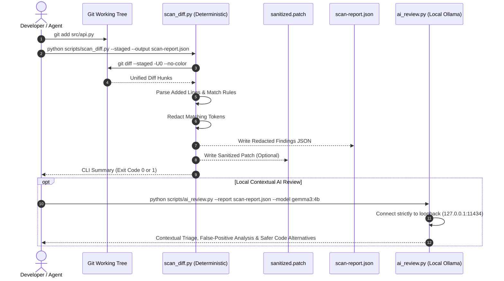
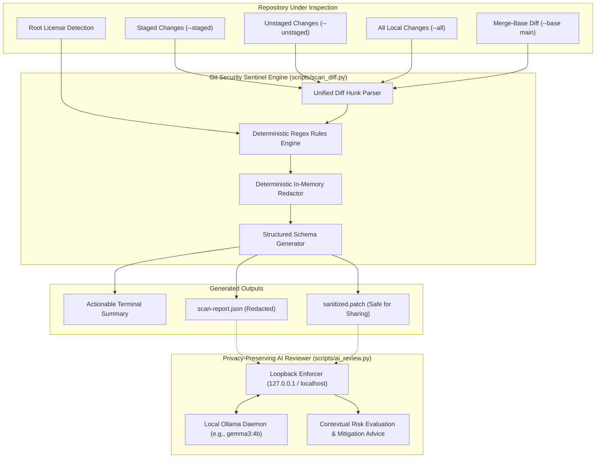

# Git Security Sentinel

> **Catch risky Git changes before they become security incidents.**

[](LICENSE)
[](https://www.python.org/)
[](https://agentskills.io/specification)
[](https://github.com/INSVikrant54/Git-Security-Sentinel/actions)
[-success)](scripts/scan_diff.py)
[-purple)](scripts/ai_review.py)

---

## 1. Project Overview

**Git Security Sentinel** is a privacy-first, zero-runtime-dependency AI security reviewer and Agent Skill designed to safeguard the software development lifecycle before code is committed or published.

It addresses code hygiene and secret exposure at the most critical juncture: the Git diff. Conforming to the [Agent Skills Open Standard](https://agentskills.io/specification), Git Security Sentinel functions both as an autonomous skill for AI coding assistants and as a developer CLI and CI pipeline tool.

---

## 2. The Problem and Why It Matters

Accidental credential exposure remains one of the most common causes of infrastructure breaches:
- **Permanent Git History Leaks**: Once committed and pushed to a remote repository, credentials (API keys, AWS IAM keys, OAuth tokens) are indexed by scrapers within seconds. Revocation and rotation is expensive, disruptive, and often neglected.
- **Privacy Trade-offs of Cloud Code Reviewers**: Many modern AI review platforms send private source code diffs to third-party hosted cloud APIs, introducing data leakage risks for proprietary codebases.
- **Complex Dependency Chains**: Traditional static security platforms often require heavy node or python virtual environments, complex docker containers, or SaaS subscriptions just to inspect pre-commit changes.

**Git Security Sentinel** solves this by delivering **instant deterministic scanning** using Python standard library alone, complemented by **100% private local AI contextual review** running on developer hardware.

---

## 3. Solution and Architecture

Git Security Sentinel operates via two decoupled layers:

1. **Deterministic Static Engine (`scripts/scan_diff.py`)**:
   - Zero third-party packages (Python standard library only).
   - Fast, transparent regex rule engine matching verified credential patterns and unsafe dynamic constructs.
   - Hunk-aware unified Git diff parser that pinpoints exact file paths and added line numbers.
   - Deterministic redaction pipeline that scrubs matching tokens before printing or exporting.
2. **Local AI Security Reviewer (`scripts/ai_review.py`)**:
   - Optional contextual layer powered by local open-weight language models (e.g. `gemma3:4b`) via [Ollama](https://ollama.com).
   - Evaluates whether findings are true security risks or benign test fixtures.
   - Operates strictly over loopback interfaces (`127.0.0.1`); code never leaves the local machine.

---

## 4. Key Features

- ⚡ **Zero Runtime Dependencies**: Runs immediately on any Python 3.9+ installation without `pip install`.
- 🛡️ **Guaranteed Secret Redaction**: Deterministically masks secrets (`[REDACTED]`) in CLI output, JSON reports, sanitized patches, and AI prompts.
- 🔒 **Private Local AI Triage**: Contextual reasoning via local Ollama models; no cloud telemetry or external API calls.
- 🎯 **Flexible Scope**: Granular scanning options for `--staged`, `--unstaged`, `--all`, `--base <branch>`, or diff files via stdin.
- 📦 **Agent Skills Open Standard**: Complete `SKILL.md` ready for integration with compatible AI agent environments.
- 📜 **Open-Source Compliance**: Verifies the presence of root license files (`LICENSE`, `LICENSE.md`, etc.).
- 🚦 **Predictable Exit Codes**: Returns `0` for clean scans, `1` when findings meet or exceed configured severity, and `2` for errors.

---

## 5. Example Workflow



---

## 6. Architecture Diagram



---

## 7. Repository Structure

```
git-security-sentinel/
├── SKILL.md                          # Agent Skill specification (YAML frontmatter + instructions)
├── README.md                         # Comprehensive documentation and project guide
├── LICENSE                           # MIT Open Source License
├── .gitignore                        # Python caches, local scan outputs, patch files
├── CONTRIBUTING.md                   # Developer guide and coding conventions
├── SECURITY.md                       # Vulnerability reporting procedure and privacy guarantees
├── .github/
│   └── workflows/
│       └── security-scan.yml         # Multi-version Python CI pipeline
├── scripts/
│   ├── scan_diff.py                  # Core deterministic diff scanner (Zero dependencies)
│   └── ai_review.py                  # Local Ollama AI reviewer (Standard library HTTP client)
├── tests/
│   └── test_scan_diff.py             # Built-in unittest test suite (22+ unit and integration tests)
├── examples/
│   ├── clean-report.json             # Example report demonstrating clean scan with 0 findings
│   └── findings-report.json          # Example report demonstrating redacted multi-severity findings
└── references/
    └── detection-rules.md            # Complete catalog of detection rules and mitigation steps
```

---

## 8. Prerequisites

- **Python**: Version 3.9 or newer (tested on 3.9, 3.10, 3.11, 3.12, 3.13).
- **Git**: Installed and available in your system `PATH`.
- **Operating System**: Linux, macOS, or Windows.
- *(Optional)* **Ollama**: For AI contextual review ([https://ollama.com](https://ollama.com)).

---

## 9. Installation and Setup

Git Security Sentinel requires **no pip dependencies**. Clone the repository and run immediately:

```bash
git clone https://github.com/INSVikrant54/Git-Security-Sentinel.git
cd Git-Security-Sentinel
python scripts/scan_diff.py --help
```

---

## 10. Static Scan Commands

### Scan Staged Changes (Pre-Commit Check)
```bash
python scripts/scan_diff.py --staged
```

> **💡 Pro-Tip: 1-Word Shortcut (`git scan` & `git scan --ai`)**  
> Teach Git to run the scanner automatically by adding an alias:  
> ```bash
> git config alias.scan "!python scripts/scan_diff.py --staged"
> ```  
> From then on, simply run:  
> ```bash
> # Deterministic offline scan:
> git scan
>
> # Unified AI Security Review (Gemma 3 / Ollama or Gemini):
> git scan --ai
> ```  
> *Want AI review enabled on every staged scan by default?*  
> ```bash
> git config alias.scan "!python scripts/scan_diff.py --staged --ai"
> ```

### Unified AI-Powered Diff Scan (Gemma & Multi-Provider)
Run deterministic secret detection, in-memory redaction, and local Gemma contextual analysis in a **single command**:
```bash
# 1. Automatic: Uses local Gemma (via Ollama) or cloud key if configured:
python scripts/scan_diff.py --staged --ai

# 2. Local Gemma with Ollama explicitly:
python scripts/scan_diff.py --staged --ai --provider ollama --model gemma3:4b

# 3. Google AI Studio (Gemini):
python scripts/scan_diff.py --staged --ai --provider gemini --model gemini-1.5-flash
```

### Scan Unstaged Changes (Working Tree Review)
```bash
python scripts/scan_diff.py --unstaged
```

### Scan All Uncommitted Local Changes
```bash
python scripts/scan_diff.py --all
```

### Scan Branch Against Base (Pull Request Simulation)
```bash
python scripts/scan_diff.py --base main
```

### Generate Machine-Readable JSON Report
```bash
python scripts/scan_diff.py --all --format json --output scan-report.json
```

### Export a Sanitized Diff Patch (Secrets Stripped)
```bash
python scripts/scan_diff.py --all --redacted-diff-out sanitized.patch
```

### Adjust Failure Severity Threshold
```bash
# Fail only on critical findings (exit code 1)
python scripts/scan_diff.py --all --severity-threshold critical

# Fail on medium, high, or critical findings
python scripts/scan_diff.py --all --severity-threshold medium
```

---

## 11. AI Reviewer Setup & Multi-Provider Guide

The AI reviewer provides deep contextual triage and safe code remediation, supporting **local open-weight models** (Gemma via Ollama) as well as **cloud AI providers** (Google AI Studio, Groq, OpenAI) using Python's standard library (`urllib.request`) with zero pip dependencies.

### Option A: Local Ollama & Gemma (100% Private, Zero Key, Offline)
1. Install and start Ollama from [ollama.com](https://ollama.com): `ollama serve`
2. Pull Gemma 3 or Gemma 2:
   ```bash
   ollama pull gemma3:4b
   # or
   ollama pull gemma2:2b
   ```
3. Run the review directly:
   ```bash
   git scan --ai
   # or standalone:
   python scripts/ai_review.py --report scan-report.json --provider ollama --model gemma3:4b
   ```

### Option B: Google AI Studio (Gemini API)
1. Get a free API key from [aistudio.google.com](https://aistudio.google.com).
2. Set your environment variable:
   ```powershell
   $env:GEMINI_API_KEY = "your_google_ai_studio_api_key"
   ```
3. Run the review (automatically selects Gemini):
   ```bash
   python scripts/ai_review.py --report scan-report.json --provider gemini --model gemini-1.5-flash
   ```

### Option C: Groq or OpenAI
1. Set the respective API key:
   ```powershell
   $env:GROQ_API_KEY = "gsk_..."      # For ultra-fast Groq Llama-3.3-70B
   $env:OPENAI_API_KEY = "sk-..."     # For OpenAI GPT-4o-mini
   ```
2. Run the review:
   ```bash
   python scripts/ai_review.py --report scan-report.json --provider groq --model llama-3.3-70b-versatile
   python scripts/ai_review.py --report scan-report.json --provider openai --model gpt-4o-mini
   ```

### Option D: Machine-Readable Structured JSON Mode (For AI Agents & Bots)
Add `--format json` to any provider command to receive validated JSON triage:
```bash
python scripts/ai_review.py --report scan-report.json --format json --output ai-review.json
```
In `--format json` mode, findings are structured with:
- `assessment`: `genuine_risk | likely_false_positive | context_dependent`
- `risk_explanation`: Contextual threat explanation.
- `safe_alternative`: Remediation snippet or pattern.

---

## 12. Sample JSON Report

Below is an authentic sample JSON output generated by `scripts/scan_diff.py` (available in `examples/findings-report.json`):

```json
{
  "scanner": "git-security-sentinel",
  "version": "1.0.0",
  "status": "completed",
  "scan_mode": "all",
  "findings": [
    {
      "rule_id": "secret.aws_access_key",
      "category": "secrets",
      "severity": "critical",
      "confidence": "high",
      "file": "deploy/terraform/main.tf",
      "line": 42,
      "message": "Potential AWS Access Key ID detected.",
      "evidence": "access_key = \"[REDACTED:AWS_KEY_ID]\"",
      "recommendation": "Never hardcode AWS keys. Use environment variables (AWS_ACCESS_KEY_ID), IAM roles, or AWS Secrets Manager."
    },
    {
      "rule_id": "secret.github_token",
      "category": "secrets",
      "severity": "critical",
      "confidence": "high",
      "file": "src/services/github_sync.py",
      "line": 18,
      "message": "Potential GitHub personal access or OAuth token detected.",
      "evidence": "gh_token = \"[REDACTED:GITHUB_TOKEN]\"",
      "recommendation": "Revoke and rotate the GitHub token immediately in GitHub Settings > Developer settings."
    }
  ],
  "license": {
    "root_license_present": true,
    "license_file": "LICENSE"
  },
  "summary": {
    "total": 2,
    "critical": 2,
    "high": 0,
    "medium": 0,
    "low": 0
  },
  "errors": []
}
```

---

## 13. Detection Rules and Severity Definitions

| Rule ID | Category | Severity | Confidence | Target Pattern |
|---|---|---|---|---|
| `secret.aws_access_key` | `secrets` | `critical` | `high` | Standard AWS Key IDs (`AKIA...`, `ASIA...` + 16 chars) |
| `secret.aws_secret_key` | `secrets` | `critical` | `high` | `aws_secret_key` assignments with 40-char Base64 strings |
| `secret.github_token` | `secrets` | `critical` | `high` | Personal access & OAuth tokens (`ghp_`, `gho_`, `github_pat_`) |
| `secret.slack_token` | `secrets` | `high` | `high` | Slack API tokens (`xoxb-`, `xoxp-`, `xoxa-`, `xoxs-`) |
| `secret.private_key` | `secrets` | `critical` | `high` | PEM/OpenSSH headers (`-----BEGIN ... PRIVATE KEY-----`) |
| `secret.generic_credential` | `secrets` | `high` | `medium` | Hardcoded assignments to `password`, `api_key`, `client_secret` |
| `risk.eval_execution` | `insecure_code` | `medium` | `medium` | Dangerous dynamic code execution (`eval()`, `exec()`) |
| `risk.localhost_endpoint` | `configuration` | `low` | `high` | Hardcoded loopback service URIs (`http://localhost...`) |
| `compliance.root_license` | `compliance` | `info` | `high` | Presence of `LICENSE`, `LICENSE.md`, `LICENSE.txt`, `COPYING` |

*For complete rule logic, false-positive exclusions, and remediation details, see [references/detection-rules.md](references/detection-rules.md).*

---

## 14. Privacy and Secret-Redaction Guarantees

Git Security Sentinel enforces strict privacy invariants:

1. **In-Memory Token Masking**: Detected credentials are intercepted and replaced with `[REDACTED:<TYPE>]` at the detection stage before any serialization occurs.
2. **Safe Artifact Generation**: Reports saved via `--output` and patches generated via `--redacted-diff-out` never contain raw secret bytes.
3. **Loopback Protection**: `scripts/ai_review.py` rejects remote endpoints by default, ensuring code diffs are never accidentally dispatched across the internet.

---

## 15. GitHub Actions Integration

Git Security Sentinel integrates effortlessly into GitHub Actions CI workflows without installing third-party Python packages:

```yaml
name: Security Scan
on: [pull_request]

jobs:
  security-check:
    runs-on: ubuntu-latest
    steps:
      - uses: actions/checkout@v4
        with:
          fetch-depth: 0

      - uses: actions/setup-python@v5
        with:
          python-version: "3.11"

      - name: Scan PR Changes
        run: |
          python scripts/scan_diff.py --base "${{ github.event.pull_request.base.ref }}" --severity-threshold high
```

---

## 16. Testing Instructions

The test suite in `tests/test_scan_diff.py` uses Python's standard `unittest` framework:

```bash
# Run all unit and integration tests with verbose output
python -m unittest discover -s tests -p "test_*.py" -v

# Verify compilation of all scripts
python -m py_compile scripts/scan_diff.py scripts/ai_review.py tests/test_scan_diff.py
```

All credential fixtures in `tests/test_scan_diff.py` are generated **dynamically in memory** using string concatenation to avoid triggering false alarms in static scanners inspecting this repository.

---

## 17. Known Limitations and False Positives

- **Static Scope**: Static regular expressions cannot determine whether a detected API key is active or functional in external third-party services.
- **Obfuscated Credentials**: Tokens generated dynamically via string concatenation or environment decoders cannot be detected by static regex scanning alone.
- **Benign Configuration**: Test fixtures containing non-sensitive test passwords or loopback bindings (`localhost:3000`) may be flagged with `medium` or `low` severities; use `--severity-threshold high` to suppress these in automated CI gates.

---

## 18. Threat Model and Non-Goals

### In Scope
- Detecting accidental credential commits in Git diffs.
- Identifying high-risk dynamic execution functions (`eval()`, `exec()`).
- Highlighting unparameterized localhost endpoints before deployment.
- Verifying root open-source license file presence.

### Non-Goals
- Full Abstract Syntax Tree (AST) deep taint analysis.
- Live network verification or active credential validation.
- Automatic, unprompted code modification or auto-commits.
- Replacing comprehensive enterprise secret vaults.

---

## 19. Contribution Guidelines

Contributions are warmly welcomed! Please read [CONTRIBUTING.md](CONTRIBUTING.md) for details on our code style, test expectations, and pull request workflow.

---

## 20. Roadmap

- [x] Deterministic diff scanning for staged, unstaged, and base branch changes.
- [x] In-memory secret redaction pipeline.
- [x] Root license verification.
- [x] Agent Skills Open Standard (`SKILL.md`) integration.
- [x] Privacy-preserving local Ollama AI contextual reviewer.
- [x] GitHub Actions multi-version CI workflow.
- [ ] Pre-commit hook installer (`python scripts/scan_diff.py --install-hook`).
- [ ] Custom user rule configuration file (`.sentinelrules.json`).
- [ ] SARIF output format for GitHub Advanced Security code scanning tabs.

---

## 21. License

This project is licensed under the **MIT License**. See the [LICENSE](LICENSE) file for complete terms.

---

## 22. Hacktoberfest Hack Day Ranchi 2026 Submission Context

- **Category**: Best Open-Source AI Project
- **Event**: Hacktoberfest Hack Day Ranchi 2026
- **Specification**: Conforms to the [Agent Skills Open Standard](https://agentskills.io/specification).
- **Core Value Proposition**: Demonstrating that open-source AI security tools can be private, transparent, dependency-free, and accessible to any developer without cloud dependencies or paid APIs.